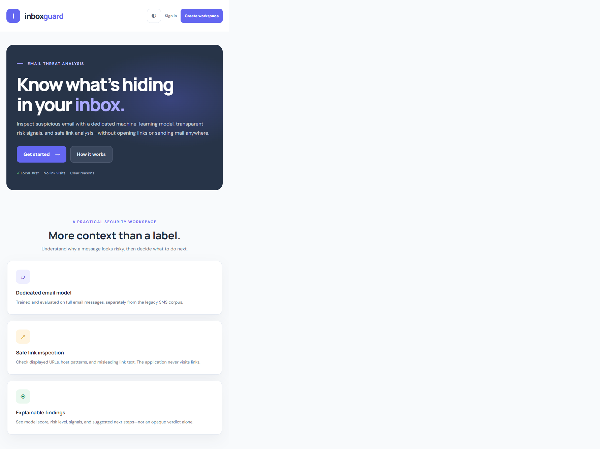
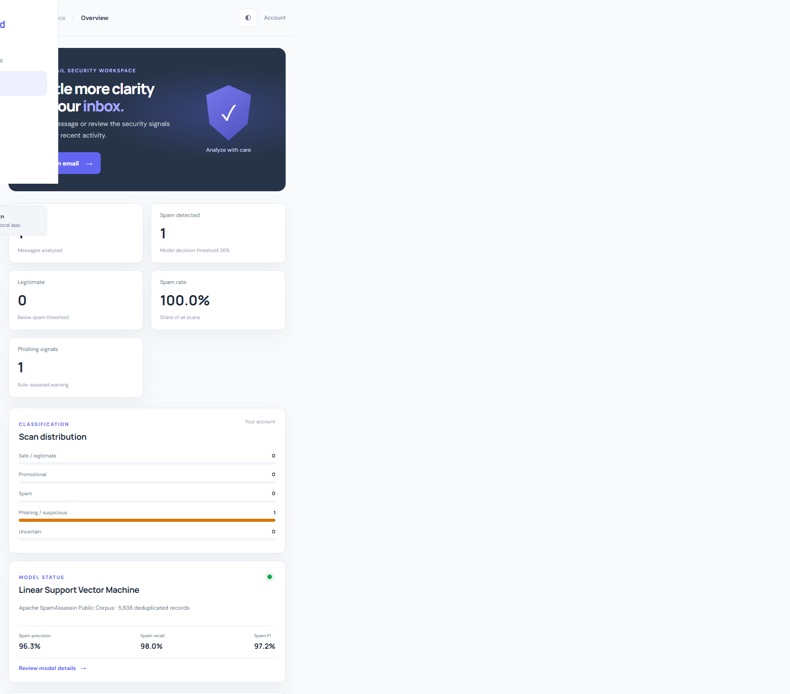
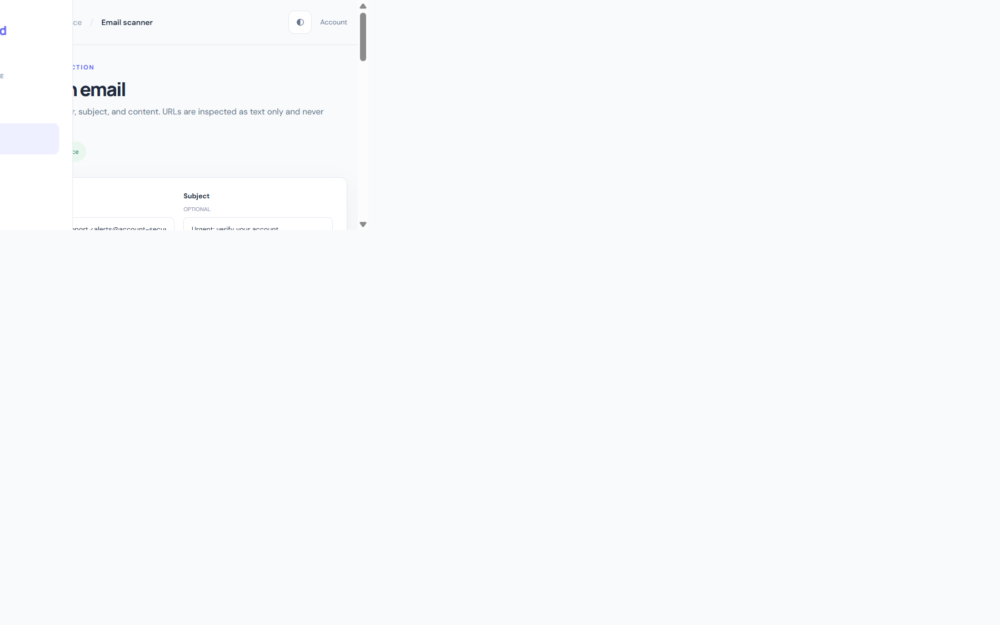
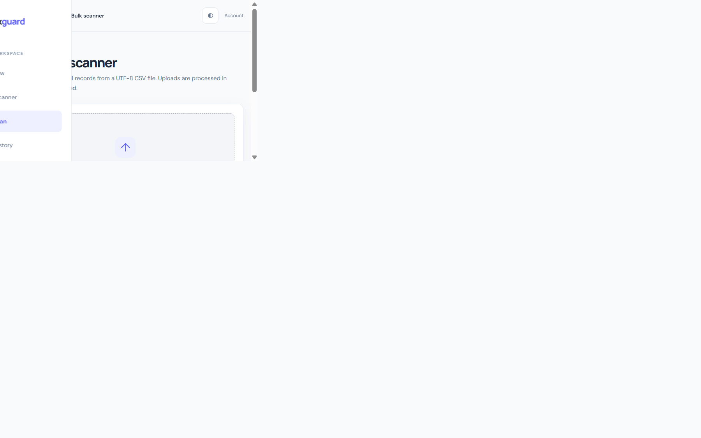
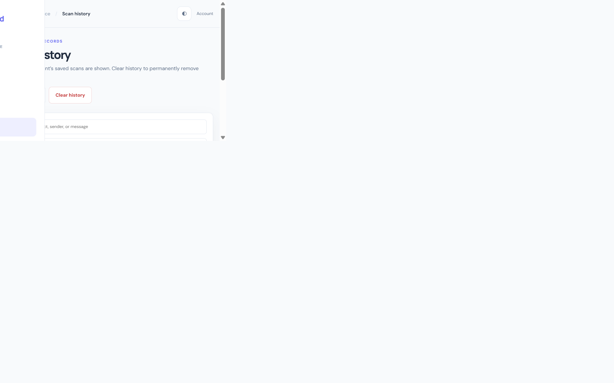
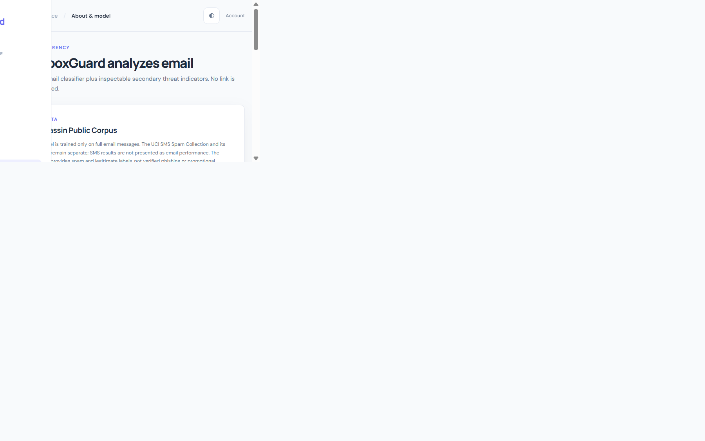

# InboxGuard — Email Security Analysis Project Report

## Abstract

InboxGuard is a local-first email-analysis web application for identifying spam and surfacing suspicious email indicators. Its email model is trained on the Apache SpamAssassin Public Corpus, kept separate from the pre-existing UCI SMS Spam Collection model. The Flask application supports account-isolated history, email and CSV scans, analytics, URL inspection without network requests, and an uncertainty-aware result view.

## 1. Problem statement and objectives

Email messages may contain unsolicited advertising, scams, credential requests, sender impersonation, or risky links. A binary text classifier can identify patterns learned from labeled examples, but cannot independently verify every sender or destination. InboxGuard combines the trained model with transparent supplementary findings and makes the limitations visible.

Objectives:

1. Prepare an email-specific dataset with normalized labels, duplicate handling, and MIME/HTML extraction.
2. Compare five text and structural classifiers using leakage-aware grouped splits.
3. Keep the final test partition at realistic class prevalence and report false positives as well as recall.
4. Build a Flask application for single and bulk analysis, local accounts, private history, and analytics.
5. Explain the model result and secondary risk signals without fetching any submitted URL.

## 2. Dataset and preparation

The email workflow uses the Apache SpamAssassin Public Corpus. Its source labels are standardized to `spam` and `legitimate`. The MIME inspector extracts subject, sender, plain-text content, and HTML content; attachments are not opened or executed. Empty and invalid rows are skipped, exact duplicates are removed, and normalized content fingerprints group duplicate or templated emails. Conflicting duplicate groups are excluded rather than allowing identical content to cross classes or splits.

The UCI SMS Spam Collection and its trained SMS artifact are retained as a separate task. No SMS examples or SMS metrics are used to describe email performance.

## 3. Machine-learning workflow

1. Normalize email subject, text, sender, HTML-derived text, and URL-domain features.
2. Split with stratified, group-aware folds. Use a validation partition for model selection and reserve an untouched test partition with natural class balance.
3. Fit TF-IDF and structural transforms only on training data.
4. Compare Multinomial Naive Bayes, Logistic Regression, Linear SVM, Random Forest, and HistGradientBoosting.
5. For each model, compare original imbalanced training with random undersampling of training rows only. Validation and test rows are never balanced.
6. Select by a spam F1/PR-AUC composite with a false-positive-rate penalty. Report accuracy, spam precision/recall/F1, ROC-AUC, PR-AUC, confusion matrices, and false-positive/negative rates.
7. Calibrate the selected pipeline on a separate, unbalanced development subset. Tune its operating threshold on another group-aware development holdout; do not use the test set for model, calibration, or threshold selection.
8. Evaluate the final calibrated pipeline at the selected threshold on the untouched test set.
9. Serialize the complete model pipeline and metadata with joblib.

The measured metrics are generated at training time in `reports/email/email_evaluation_metrics.json`; do not copy performance figures from SMS results or treat an aspirational 99% target as an observed result. The test corpus is historical and cannot guarantee performance on newer mail.

## 4. Detection and threat analysis

The trained spam model is the primary content classifier. A separate detection layer inspects credential and payment wording, urgency, attachments mentioned in text, suspicious URL structures, mismatched link text, and sender-brand signals. It reports a rule-based risk score separately from the model score. Categories such as phishing, promotional, and uncertain are secondary assessments; the SpamAssassin source labels do not supervise those categories. Scores around the configured decision boundary are shown as uncertain.

The system does not fetch URLs, follow redirects, open attachments, or connect to a mail server. Link findings are based only on submitted content.

## 5. Application architecture

- **Frontend:** Flask/Jinja pages, responsive custom CSS, browser-side JSON and CSV interactions, persistent theme selection.
- **Backend:** Flask routes for registration/login, dashboard, single/raw/bulk scans, model details, history, export, and statistics.
- **Model service:** Loads only the email-specific joblib pipeline for email scans. It never silently falls back to the SMS model.
- **Database:** SQLite account and scan records locally, or PostgreSQL when deployed to Vercel. SQLite migrations preserve earlier SMS history; prediction queries scope records to the signed-in user.
- **Security controls:** Werkzeug password hashing, session cookies, CSRF token checks, input and upload limits, no automatic URL requests, and in-memory upload processing.

This project is intended for educational use, not as a production mail gateway. It has no external email integration, password recovery, email verification, or deployment-grade rate limiting.

## 6. Installation and execution

```powershell
py -3.12 -m venv .venv
.\.venv\Scripts\python.exe -m pip install -r requirements-dev.txt
.\.venv\Scripts\python.exe -m pytest -q
.\.venv\Scripts\python.exe run.py
```

The trained email artifact is included, so scanning works without downloading the corpus or retraining. To reproduce training, download the datasets and follow `data/README.md`, then run `scripts\inspect_email_corpus.py` and `scripts\train_email_model.py`. Open `http://127.0.0.1:5000` and create a local account. Application startup without the email model remains explicit: email scan endpoints return HTTP 503 rather than using a demo model or the SMS artifact.

Raw corpora and derived email text splits are excluded from Git; see
`data/README.md` for dataset sources and local setup.

## 7. Evaluation and testing

The exact model comparison, final held-out metrics, calibration Brier score, class distribution, and split counts are written to `reports/email/email_evaluation_metrics.json`. The SVG figures include dataset distribution, algorithm comparison, test metrics, confusion matrix, ROC curve, and precision-recall curve.

`pytest -q` covers registration and login routes, per-user history isolation, input validation, raw MIME parsing, bulk upload/export, additive database migration, URL indicators, uncertainty behavior, duplicate loading, and group-aware train-only undersampling. Route tests use a test-only stub estimator and do not claim model performance.

The current trained artifact selected the original-imbalance Linear SVM, with a threshold of 0.26 selected on a separate development holdout. On 1,168 untouched test messages (820 legitimate, 348 spam), the deployed calibrated pipeline achieved 98.29% accuracy, 96.33% spam precision, 97.99% spam recall, 97.15% spam F1, 99.87% ROC-AUC, 99.71% PR-AUC, and a 0.0129 Brier score. Its confusion matrix was TN=807, FP=13, FN=7, TP=341. The development threshold holdout achieved 98.54% precision, 97.12% recall, and 2 false positives among 328 legitimate messages; these are threshold-selection metrics, not final test results.

For the Linear SVM candidate comparison at natural test prevalence, train-only undersampling raised spam recall from 97.70% to 97.99%, while precision declined from 97.70% to 96.33% and false positives rose from 8 to 13. The selected deployed model therefore uses original imbalanced training. These historical corpus results do not guarantee performance on newer email. The generated figures include word frequency as well as dataset distribution, model comparison, test metrics, confusion matrix, ROC, and precision-recall curves.

## 8. Limitations and future work

- The SpamAssassin corpus is dated and only provides spam/legitimate labels.
- No sender reputation, DNS, authentication-header, attachment sandbox, or redirect-chain inspection is performed.
- Rule-based risk scoring is transparent but does not estimate probability of compromise.
- Local SQLite or hosted PostgreSQL storage keeps submitted scan text until cleared; sensitive data should not be uploaded.
- Additional recent, consented email corpora and time-based external validation are needed before operational use.
- Production deployment would require HTTPS, account recovery/verification, rate limiting, retention controls, model monitoring, and security review.

## 9. Viva questions and answers

1. **Why are the SMS and email datasets separate?** Their message lengths and distributions differ; pooling them without task-specific validation can misrepresent email performance.
2. **Why TF-IDF word and character features?** Word n-grams capture lexical context; character n-grams can capture obfuscation, misspellings, and formatting patterns.
3. **Why use grouped splitting?** Normalized duplicates or copied templates should not appear in both training and evaluation partitions.
4. **Why keep a realistic test distribution?** Deployment prevalence affects precision and false-alarm rates; a balanced test set can give misleading operational results.
5. **How is the training set balanced?** By undersampling only after splitting. Validation and test distributions remain unchanged.
6. **Why report false positives?** A legitimate message marked as spam can hide important communication, so recall is not the only objective.
7. **What does calibration provide?** A mapping of model scores to estimated class probabilities, validated on data not used to fit the underlying model; it does not ensure calibration under future distribution shift.
8. **Does a suspicious label prove phishing?** No. It is an advisory result based on model evidence and transparent heuristics; the dataset does not contain verified phishing labels.
9. **Why not automatically inspect a URL?** Visiting arbitrary links risks tracking or server-side exposure and may follow malicious redirects.
10. **Can “safe” guarantee no threat?** No. It means this model and these rules did not produce a stronger warning; independent verification is still necessary.

## Screenshots

Model-visualization SVGs are included under `reports/email/figures/`. The interface captures below use a temporary local account and synthetic content; avoid exposing account or email content in future screenshots.

Representative UI captures made with a temporary local account and synthetic content:







