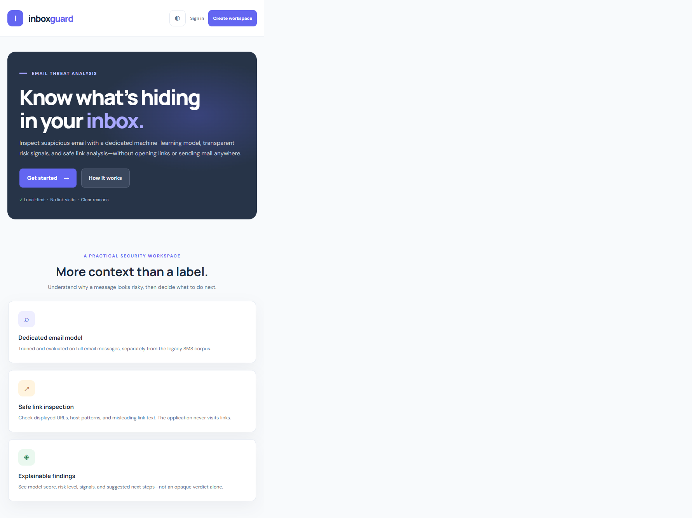
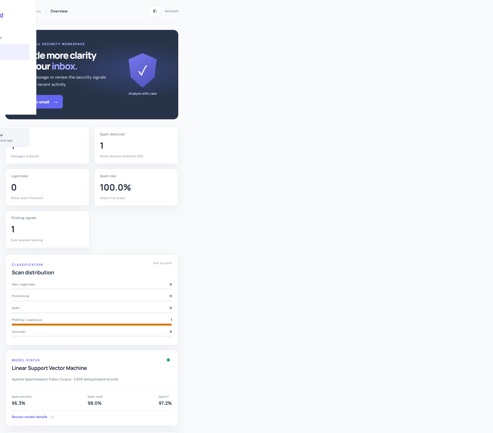
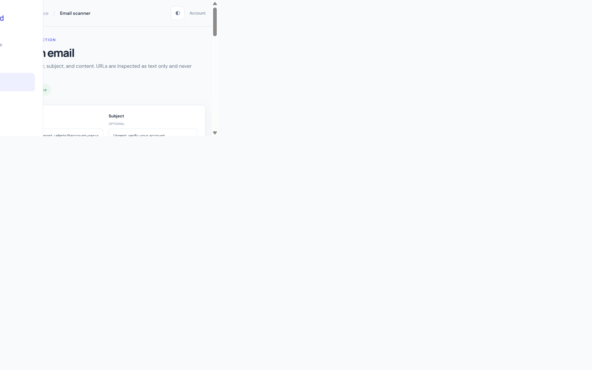
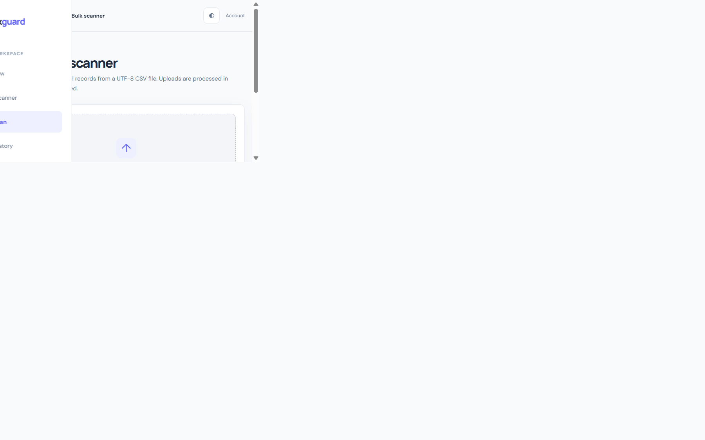
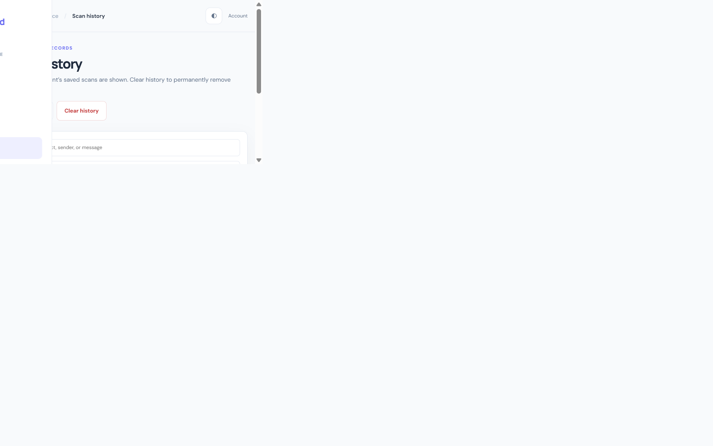
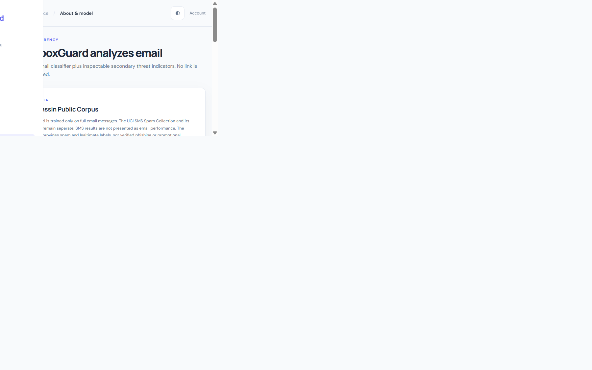
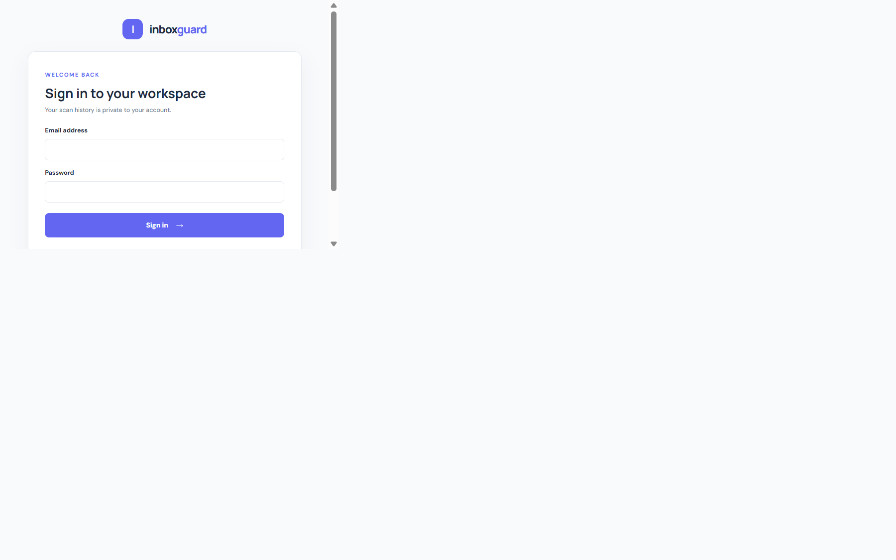
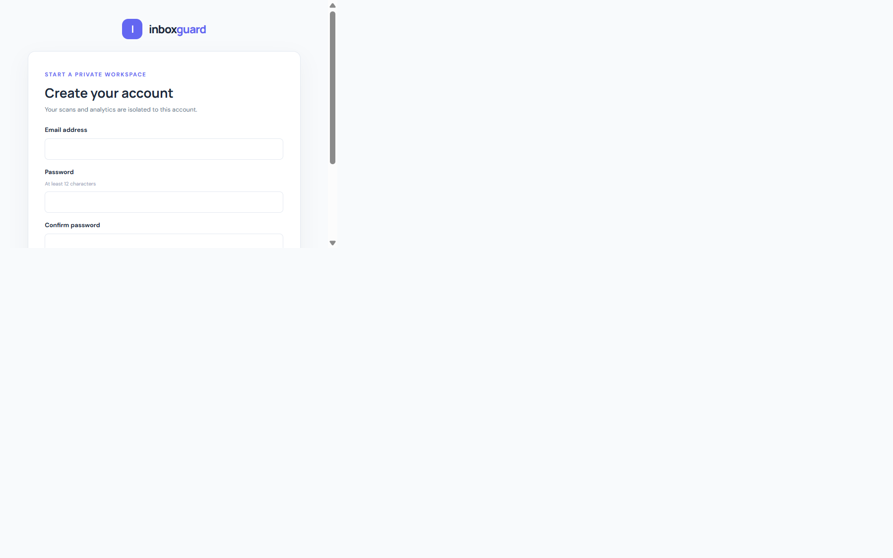

# InboxGuard — Email Security Analysis

InboxGuard is a local-first, educational email security web application. It combines an email-specific supervised machine-learning model with transparent secondary indicators for suspicious wording, sender impersonation, and URL patterns. It includes account login, isolated scan history, individual and CSV bulk scanning, analytics, model reports, and light/dark themes.

> **Scope and safety:** The email model is trained on Apache SpamAssassin emails. The original UCI SMS model and data remain separate and are not used to make email predictions. The SpamAssassin labels are only `spam` and `legitimate`; phishing and promotional labels in the UI are rule-assisted assessments, not independently trained classes. URL analysis is offline: the app never visits submitted links. Results are advisory and cannot guarantee that an email is safe.

## Features

- Email scanning by sender, subject, body, optional HTML, or pasted raw MIME email.
- Calibrated spam score (only when the trained artifact and evaluation report are present), risk level, findings, suspicious phrases/URLs, and recommended actions.
- Uncertainty band near the classification boundary rather than a forced confident label.
- Bulk UTF-8 CSV analysis (maximum 5 MB and 500 messages) with batch CSV export
  including the scanned message text.
- User registration and sign-in; password hashes and account-scoped SQLite
  history locally or PostgreSQL history on Vercel.
- Dashboard statistics, searchable/filterable history, CSV export including
  scanned message text, and confirmed history deletion.
- Responsive interface, persistent light/dark preference, API input limits, and CSRF protection.

## Architecture

```text
Browser (templates + CSS + JavaScript)
    │ authenticated Flask JSON API
    ├── /api/scan       subject/body or parsed raw email
    ├── /api/bulk       in-memory CSV processing
    └── /api/history    per-user history, export and statistics
             │
             ├── EmailSecurityModel ── calibrated scikit-learn email pipeline
             ├── Detection engine ──── transparent supplementary rules
             └── SQLite / PostgreSQL ─ users, predictions, batch metadata

SpamAssassin email archives ── scripts/inspect_email_corpus.py
                               scripts/train_email_model.py
                               models/email_security_model.joblib
                               reports/email/email_evaluation_metrics.json

UCI SMS dataset ────────────── scripts/train_model.py
                               models/spam_classifier.joblib (kept separate)
```

### Project structure

```text
backend/                 Flask routes, SQLite/PostgreSQL, email features and detection engine
data/README.md            Dataset download and local training instructions
data/raw/, data/processed/ Local-only datasets and grouped splits (Git-ignored)
frontend/templates/       Landing, auth, dashboard, scanner, bulk, history, about
public/static/            Responsive CSS and browser-side API interactions
instance/                 Local SQLite database (created at runtime)
models/                   Separate SMS and email model artifacts
reports/email/            Email metrics, model comparison, and SVG charts
scripts/                  Corpus inspection and SMS/email training workflows
tests/                    API, database migration, feature, and split tests
```

## Machine-learning workflow

1. Parse SpamAssassin MIME messages into subject, sender, plain text, and HTML fields. Skip empty/corrupt records and remove exact and normalized duplicate groups.
2. Keep the email corpus separate from the UCI SMS dataset.
3. Use stratified, group-aware splits. The realistic test partition remains untouched during model selection and threshold calibration.
4. Fit subject/body word TF-IDF, body character TF-IDF, sender features, and structural features only within training partitions.
5. Compare Multinomial Naive Bayes, Logistic Regression, Linear SVM, Random Forest, and HistGradientBoosting, on original and train-only undersampled data. Validation and test partitions retain their natural class distribution.
6. Select using spam F1/PR-AUC with a false-positive-rate penalty; report accuracy, precision, recall, F1, ROC-AUC, PR-AUC, confusion matrices, and false-positive/negative rates.
7. Calibrate on a separate unbalanced development subset. Select the operating threshold on another group-aware development holdout, targeting maximum recall subject to validation precision >= 0.95 and false-positive rate <= 0.02.
8. Report Brier score and final untouched-test metrics; the test set is not used to select the model, calibration, or threshold.
9. Save the complete pipeline, metadata, data splits, and charts. See [MODEL_DETAILS.md](./MODEL_DETAILS.md) for precise definitions and the generated report for measured results.

No 99% performance is promised. Metrics must come from the actual generated evaluation report; results should not be inferred from SMS data or sample messages.

### Current measured email-model results

The current SpamAssassin run retained 5,838 deduplicated emails and selected the original-imbalance Linear SVM pipeline. On the untouched 1,168-message test set (820 legitimate, 348 spam), the calibrated deployed pipeline achieved 98.29% accuracy, 96.33% spam precision, 97.99% spam recall, 97.15% spam F1, 99.87% ROC-AUC, and 99.71% PR-AUC. It produced 13 false positives and 7 false negatives; the Brier score was 0.0129. The selected decision threshold is 0.26, tuned on a separate development holdout (precision 98.54%, recall 97.12%, and 2 false positives among 328 legitimate messages).

These are corpus-specific results, not a 99% guarantee or evidence of performance on current real-world email. In the separate candidate comparison, undersampling improved Linear SVM spam recall from 97.70% to 97.99% but lowered precision from 97.70% to 96.33% and increased false positives from 8 to 13 on the natural-prevalence test set. The deployed model uses the original, imbalanced training distribution. Full results are in `reports\email\email_evaluation_metrics.json` and `reports\email\email_model_comparison.csv`.

## Setup on Windows PowerShell

Python 3.12 is the validated runtime. The included email model was serialized with scikit-learn 1.9.1, pinned in `requirements.txt`. From the project directory:

```powershell
py -3.12 -m venv .venv
.\.venv\Scripts\python.exe -m pip install --upgrade pip
.\.venv\Scripts\python.exe -m pip install -r requirements-dev.txt
```

On this workstation, Windows Application Control blocked native NumPy DLLs installed into an isolated environment. The existing approved Anaconda Python 3.12.7 environment is therefore used through a `.venv` created with `--system-site-packages`; this reuses its installed packages without bypassing policy. On a restricted machine, use only an administrator-approved Python environment. On an unrestricted machine, use the standard isolated-install commands above.

The five SpamAssassin archives are available from the [Apache SpamAssassin public corpus](https://spamassassin.apache.org/old/publiccorpus/). Place the five named `*.tar.bz2` archives in `data\raw\spamassassin\`:

```text
20030228_easy_ham.tar.bz2
20030228_easy_ham_2.tar.bz2
20030228_hard_ham.tar.bz2
20030228_spam.tar.bz2
20030228_spam_2.tar.bz2
```

The corpora and derived email splits are not committed: raw email can contain personal information. Follow [data/README.md](./data/README.md) to download the datasets locally. To rebuild the JSONL dataset and train the separate email model:

```powershell
.\.venv\Scripts\python.exe scripts\inspect_email_corpus.py
.\.venv\Scripts\python.exe scripts\train_email_model.py
```

Training writes `models\email_security_model.joblib`, `data\processed\email_*.csv`, and reports under `reports\email\`, including dataset distribution, word frequency, algorithm comparison, test metrics, confusion matrix, ROC, and precision-recall SVG charts. If Windows Application Control blocks a scikit-learn native module, use an administrator-approved Python environment; do not bypass the policy. A missing model is reported explicitly by the scan API as HTTP 503 rather than silently using the SMS model or a demo classifier.

## Run the application

The trained email artifact is included, so scanning works immediately after
installing dependencies. To retrain, first download the corpora as described in
[data/README.md](./data/README.md). Then start the app:

```powershell
.\.venv\Scripts\python.exe run.py
```

Open [http://127.0.0.1:5000](http://127.0.0.1:5000), create an account, and scan an email. The default Flask server binds to localhost. For stable sessions between restarts, set a private `INBOXGUARD_SECRET_KEY` environment variable; otherwise a fresh local-only key is generated at launch.

## Deploy the web app to Vercel

The Flask application is configured for Vercel's Python Functions runtime:

1. Create a managed PostgreSQL database and copy its connection URL.
2. In Vercel, choose **Add New → Project** and import
   `varshinickswamy-dot/Email-Spam-Detection`. Keep the root directory as `.`.
3. Before deploying, add `DATABASE_URL` with the PostgreSQL URL and
   `INBOXGUARD_SECRET_KEY` with a newly generated secret under **Settings →
   Environment Variables**. Generate a secret locally with
   `py -c "import secrets; print(secrets.token_urlsafe(48))"`; do not put it in
   source control or share it.
4. Leave the detected Python framework/build settings unchanged and deploy.
   Vercel uses `app.py`, `requirements.txt`, `.python-version`, `vercel.json`,
   and `public/static/`; do not set a Gunicorn start command or use `render.yaml`.

Vercel Functions do not provide durable local disk storage. Before the first
deployment, create a managed PostgreSQL database (use its pooled connection URL
if the provider offers one) and set these Vercel project environment variables
for Production, and Preview if you plan to use preview deployments:

| Variable | Value |
|---|---|
| `DATABASE_URL` | PostgreSQL connection URL from your database provider |
| `INBOXGUARD_SECRET_KEY` | A new, long, randomly generated secret kept only in Vercel |

The app creates the required account, history, and batch tables in that
PostgreSQL database on startup. Vercel forces secure session cookies. Never
commit database URLs or secret values to GitHub. Local SQLite data is not
automatically copied to PostgreSQL; the cloud database starts with new accounts
and empty scan history.

Raw corpora, derived email text splits, local databases, and virtual environments
are excluded from the public repository. The included GitHub Actions workflow
runs tests on pushes and pull requests. The bundled email model is included.

For local development, the app continues to use SQLite by default. To run it on
Render instead, the existing `render.yaml` and `requirements-deploy.txt` remain
available. Render and Vercel use different startup and persistence settings.

After deploying, test registration and sign-in, then scan an email, run a bulk
CSV scan, and confirm history remains after a new deployment. Review Vercel
function logs and your database provider's connection limits if requests fail.
The Vercel project deploys the Flask app as a function; no separate build output
directory is required.

The hosted app stores scan content in its database history. Do not submit private
or confidential email. Before public use, add appropriate rate limiting, account
verification/recovery, retention controls, a privacy notice, and security
monitoring; this educational project is not production-hardened.

## Screenshots

The generated model charts are in `reports\email\figures\`. To view the interface, start the app and visit the landing page, then create a local account to access the dashboard, scanner, bulk scanner, history, and about pages. Screenshots below use a temporary local account and synthetic messages; do not capture real account or email content.

Download the [Email Scanner Risk Guide](./reports/Email_Scanner_Risk_Guide.pdf)
for the risk-score bands, point breakdown, classification notes, and synthetic
low, medium, high, and critical examples scored with the bundled model.

The following captures were made with a temporary local account and synthetic sample content:










## API overview

All scan, model-information, history, and analytics endpoints require a signed-in session. Browser state-changing requests include a CSRF token.

| Method | Route | Description |
|---|---|---|
| `GET` | `/` | Public landing page |
| `GET/POST` | `/login`, `/register` | Local account access |
| `GET` | `/dashboard`, `/scanner`, `/bulk`, `/history`, `/about` | Authenticated application pages |
| `POST` | `/api/scan` | Analyze `{"subject":"...", "body":"...", "sender":"...", "html_body":"..."}` |
| `POST` | `/api/scan/raw` | Parse and analyze `{"raw_email":"From: ...\nSubject: ...\n\n..."}` |
| `POST` | `/api/bulk` | Multipart CSV upload |
| `GET` | `/api/bulk/<batch_id>/export` | Export a batch owned by the current user |
| `GET` | `/api/model-info` | Trained model metadata and held-out metrics |
| `GET` | `/api/history` | Search/filter the current user’s scans |
| `DELETE` | `/api/history` | Clear the current user’s history |
| `GET` | `/api/history/export` | Export the current user’s history |
| `GET` | `/api/stats` | Current user’s scan statistics |

The response’s `spam_probability` is the calibrated model score when the calibrated email artifact is loaded. It is not a probability that the sender or email is malicious. `risk_score` is a separate rule-based heuristic score, not a calibrated probability. URL lists are rendered as text and are never clickable by the app.

## Testing

```powershell
.\.venv\Scripts\python.exe -m pytest -q
```

Tests use a temporary database and an explicit stub model for route behavior; this is test-only and does not create or claim model-quality results. Run `scripts\train_email_model.py` for real corpus evaluation and inspect its generated metrics.

## Competition presentation and viva

- **Why TF-IDF?** It maps text into sparse features weighted by term importance and corpus rarity; word and character features capture complementary patterns.
- **Why train/test splits and groups?** The test partition estimates generalization on unseen emails. Grouping normalized duplicates reduces leakage from copied or templated messages.
- **Why compare multiple algorithms?** Naive Bayes is a fast probabilistic baseline; Logistic Regression and Linear SVM are effective sparse-text linear classifiers; Random Forest and HistGradientBoosting provide non-linear comparisons.
- **Why show precision and false positives?** Incorrectly flagging legitimate email can hide important messages. Recall alone is not enough.
- **What does calibration mean?** A separate development calibration subset maps model scores to probability estimates. Calibration is evaluated on held-out data; it does not mean certainty or protection from distribution shift.
- **What is the risk score?** A transparent supplementary rules score over message signals; it is not the supervised model’s probability.
- **Why not visit links?** Fetching arbitrary email links can expose the user and server to tracking, redirects, or malicious content; InboxGuard only inspects submitted text and URL structure.

## Privacy and limitations

Account credentials are locally hashed. Scan text is stored in the local SQLite database for history until the user clears it; bulk CSV files are processed in memory and are not retained as uploaded files. Avoid submitting confidential mail. The application has no email verification, password recovery, production rate limiting, or external mail integrations. The SpamAssassin dataset is dated and does not provide verified phishing, malicious-attachment, or promotional labels. A safe classification is not a security guarantee.

## Dataset credits

- Apache SpamAssassin Public Corpus: [public corpus archive](https://spamassassin.apache.org/old/publiccorpus/).
- Almeida, T. A., Gómez Hidalgo, J. M., and Yamakami, A., UCI SMS Spam Collection, DOI [10.24432/C5CC84](https://doi.org/10.24432/C5CC84). Retained for the separate SMS workflow.
